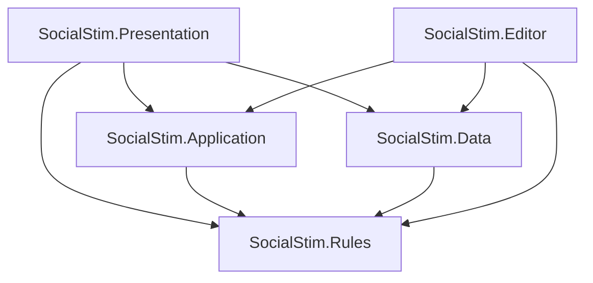

# Architecture

## Status and constraints

Milestone 01 implements the five-role participant-loop candidate. Milestone 02
adds attributed evidence, trust, constrained heuristic estimates, visible
self-exposure, coordinated team plans, and contextual dialogue. Shared Rules,
Application, and engine-free dialogue import code compile and pass behavioral
tests in GitHub Actions. Unity-specific adapters and the committed scene still
need editor import, compilation, and play verification.

Current code includes `RunFactory`, `RunSession`, `PhaseMachine`, `NightResolver`
and its stages, `SocialNpcStrategy` (default), `BasicNpcStrategy` (baseline), restricted `KnowledgeView` records,
`DialogueSelector`, `StarterWinCondition`, and `GameController`. Unity data assets
and `GameBootstrap` wire these to `TextGameView` through `GamePresenter`.
The original design contracts below also cover deferred systems: advanced roles (03), save snapshots
(04), and tension/visual effects (05). Those systems are not implemented yet.

The game is single-player and text-only initially. The player is a participant
with the same action legality rules as NPCs. Dialogue is prewritten data, with
no runtime text-generation service. Gameplay randomness is seeded with capturable
stream state; full run save/resume is milestone 04. No run state persists today.

The owner authorized milestone 02 development in parallel with their milestone
01 Unity verification. No editor success is inferred from that decision.

## Assembly dependencies

Arrows below mean "depends on". Packages are omitted from this diagram.

| Assembly | Allowed project references | Unity access |
| --- | --- | --- |
| `SocialStim.Rules` | None | `noEngineReferences: true` |
| `SocialStim.Application` | Rules | `noEngineReferences: true` |
| `SocialStim.Data` | Rules | UnityEngine; no UnityEditor at runtime |
| `SocialStim.Presentation` | Rules, Application, Data | UnityEngine, uGUI/TMP, Input System |
| `SocialStim.Editor` | Rules, Application, Data | Editor-only |
| `SocialStim.Tests.EditMode` | Rules, Application, Data | Editor-only test assembly |
| `SocialStim.Tests.PlayMode` | All runtime project assemblies | Test assembly |

Project assembly references use stable `.meta` GUIDs. `autoReferenced` is false
to prevent accidental use by predefined assemblies. Do not put project scripts
outside these assembly roots. Tests opt in through `TestAssemblies` and
`UNITY_INCLUDE_TESTS`; Editor code is restricted to the Editor platform.

Rules and Application intentionally use a stronger constraint than the brief
requires: no Unity engine dependency. Data converts ScriptableObjects into
validated plain C# definition records at composition time. This avoids exposing
mutable Unity assets or scene APIs to rules and preserves simple EditMode tests.
No extra dependency-injection framework is needed.

## Files and namespaces

One top-level type per file; matching filename. Namespace roots are
`SocialStim.Rules`, `SocialStim.Application`, `SocialStim.Data`,
`SocialStim.Presentation`, and `SocialStim.Editor`, followed by subfolder names.
Scenes, authored JSON, and asset instances live outside code namespace roots.

| Folder | Responsibility |
| --- | --- |
| `Assets/_Project/Rules/Phases` | Explicit phase states and legal transitions |
| `Assets/_Project/Rules/Commands` | Validated player and NPC action commands |
| `Assets/_Project/Rules/Roles` | Role records, abilities, attack/defense policies |
| `Assets/_Project/Rules/Night` | Ordered resolver stages and visit tracking |
| `Assets/_Project/Rules/Cast` | Seeded identities, traits, and role assignment |
| `Assets/_Project/Rules/Reasoning` | Beliefs, evidence records, strategy implementations |
| `Assets/_Project/Rules/Dialogue` | Intent selection inputs, weighted lines, anti-repetition |
| `Assets/_Project/Rules/Victory` | Faction outcomes and personal achievements |
| `Assets/_Project/Rules/Randomness` | Specified PRNG with capturable stream state |
| `Assets/_Project/Application` | Session coordination, observations, input, saves, cues |
| `Assets/_Project/Data/Definitions` | Definition types and validated runtime conversion |
| `Assets/_Project/Data/Dialogue` | Authored dialogue files; no generated runtime prose |
| `Assets/_Project/ScriptableObjects` | Role, setup, personality, catalog, and later effect assets |
| `Assets/_Project/Presentation/Text` | Text presenter, views, input, composition root |
| `Assets/_Project/Presentation/Effects` | Reserved for milestone 05 |
| `Assets/_Project/Scenes` | Future bootstrap, game, and playground scenes |
| `Assets/_Project/Editor/EffectsPlayground` | Reserved editor-only preview tooling |
| `Assets/_Project/Tests` | EditMode rules tests and PlayMode adapter tests |

Empty folders are tracked with `.gitkeep` files, which Unity ignores. Folder and
asset `.meta` files are committed; moving assets must preserve those GUIDs.

## Composition and Unity integration

One scene-facing composition root will hold the authored catalog and view
references. It will convert definitions, construct a session with constructor
injection, subscribe the presenter, and dispose subscriptions on teardown.
MonoBehaviours adapt scenes, input devices, and views; they contain no game rules.
ScriptableObject definitions are treated as immutable during a run.

Use an inspector-referenced content catalog initially. It makes content
dependencies explicit without string-based Resources lookups or Addressables
setup. Introduce Addressables only when measured content size, asynchronous
loading, or distribution requirements justify it.

Use session-scoped C# events, rather than global ScriptableObject channels, for
game observations. A globally readable private event channel is an information
leak. ScriptableObject profiles remain appropriate for authored presentation
configuration. No service locator, singleton, or global random state is planned.

## Runtime flow and patterns

1. A Factory resolves role-list constraints, player assignment, names, and traits.
2. A State machine requests commands for Discussion, Nomination, Defense,
   Judgement, LastWords, NightSelection, NightResolution, Dawn, and Ended.
3. Player input and NPC Strategy implementations submit the same Commands.
4. Rules validate phase, actor survival, knowledge, resources, and legal targets.
5. The night Pipeline resolves accepted intents in documented stages.
6. Authoritative events update run state and evidence; Application derives
   recipient-specific observations and semantic presentation cues.
7. Win-condition Strategies return faction and personal outcomes at defined
   stable boundaries. Observer subscriptions update the current view.

The first day begins with Discussion and no prior-night result. No-execution
days proceed to NightSelection. Acquittal returns to nomination when a trial
remains, otherwise proceeds to night. Execution ends trials for that day.
Daytime execution and the completed night batch are stable win-check boundaries.
Endless runs need a later documented stalemate/turn-cap policy, not an accidental
"Town wins" fallback.

Roles compose ability definitions, resources, immunities, appearances, and win
policies. New role assets reuse existing ability implementations. A genuinely
new mechanic adds a small ability/handler and explicit registration at the
composition root, without editing the resolver or state machine. IDs and handler
compatibility are validated before a run. Do not rely on reflection-based type
discovery that may fail under build stripping.

## Hidden information

Authoritative state is private to the session/rules implementation. Public
Application contracts expose only player-authorized observations, public facts,
input requests, and display cues. NPC strategies consume a restricted knowledge
snapshot and their own evidence history. Debug views require explicit opt-in
and cannot supply inputs to the strategy in normal play.

| Information | Allowed recipients |
| --- | --- |
| Public accusation, nomination, vote, claim | Living participants and spectator transcript |
| Private ability result | Acting character, unless role rules specify otherwise |
| Antagonist membership / team plan | Roles explicitly granted teammate knowledge |
| Unrevealed true role | Authoritative rules; owner if their role is known to them |
| Death role | Everyone only when reveal-on-death is enabled |
| Pending hostile action | No target notification before a legitimate report |

A claim is an assertion, not a fact. Store speaker, target, alleged role/result,
time, provenance, and audience. Contradiction detection compares assertions
with permitted evidence. A role-gated dialogue condition must use the speaker's
allowed knowledge, not a target's secret role. Do not send internal events to a
view and expect it to filter them correctly.

## Reasoning and dialogue

`BeliefState` stores attributed evidence, bounded suspicion/trust, and an exposure
estimate for one observer. `BeliefDistribution` combines bounded evidence weights
with publicly announced initial faction counts. It normalizes role and faction
estimates to 10000 basis points, excludes known unique roles elsewhere, and never
recalculates priors from unrevealed death alignments. These are heuristic beliefs,
not calibrated Bayesian posteriors or exact joint role-list inference.

Evidence distinguishes public assertions, public ballots/deaths/reveals, and
legitimate private results. Self-exposure depends on visible reactions, never
private knowledge alone. Both production strategies are stateless across observers;
state belongs to each observer's model. A new strategy must not cache one NPC's
private facts for another NPC. `KnownCharacter` contains observer estimates rather
than authoritative assignments. See `Docs/SOCIAL_REASONING.md` for model policies.

`TeamNightPlanner` accepts authorized proposals without cast-role objects. Target
selection uses proposal count, permitted threat priority, and stable ID. A player
killer controls the final target/pass. Plans enter antagonist-only knowledge and
a living antagonist player's private transcript. Town/Neutral receive neither.

Dialogue version 2 adds AND-combined predicates over public phase/day, speaker
traits/own role, assertions, permitted evidence, and visible pressure. Context is
captured before publishing a statement, so it cannot create its own eligibility.
Generic fallbacks are mandatory; anti-repetition never relaxes conditions. Schema
1 remains supported without conditions. No visual markup parser is introduced.

Difficulty changes Strategy implementations, not access to secret truth.
Antagonists share only role-authorized team facts and a deterministic target plan.
Self-exposure estimates use observed reactions, not other characters' private
beliefs. Stable ordering breaks ties before any explicitly seeded random choice.

Dialogue selection uses intent, permitted context, authored conditions, weighted
sampling, and a saved per-speaker recent-line history. Personality affects intent
utility and authored line suitability. Selection treats text as opaque, including
future markup. Adding lines must require data edits only. See
[Docs/DIALOGUE_AUTHORING.md](Docs/DIALOGUE_AUTHORING.md).

Player choices expose available assertions and likely social meaning. The normal
UI does not expose exact NPC belief deltas. Truthful and deceptive variants both
use the same command and evidence pipeline.

## Determinism and save/resume

Use `IRandomSource` backed by a specified, versioned algorithm with serializable
state; do not rely on `UnityEngine.Random` or a hidden `System.Random` state.
Separate setup, NPC decision, and dialogue streams from presentation randomness.
Sort collections by stable IDs before iteration that affects results. Use integer
weights or explicitly defined rounding in decisions; cosmetic timing is irrelevant.

A seed reproduces a run only with matching content/rules versions and the same
player commands. Mid-run snapshots must include schema version, content/rules
fingerprints, settings, seed and stream states, cast/roles/resources, current
phase and trial counters, pending commands and outstanding input, evidence and
private knowledge, belief state, dialogue repetition history, and outcomes.
Use stable IDs, never scene references or ScriptableObject instance IDs.

Save at command boundaries with a consistent snapshot. If a presentation-only
line is in progress, restore its full text instantly or replay it without
consuming gameplay/dialogue RNG. A failed or incompatible load returns a clear
error; it must not silently regenerate hidden state. Nothing crosses runs except
settings. Persistence is behind an adapter; snapshot creation stays engine-free.

## Future presentation and effects

Current ports are `IGameView` and `IPlayerInputProvider`. `GamePresenter` routes
portable option IDs to `GameController` and scoped requests back to the view.
`RunSession.Observation` emits only public/player-private records. Additional
dialogue or cue ports wait for a distinct consumer. UI objects never appear in
these payloads. A future front end implements the same ports and semantic cues.

One presenter routes all text and cues. Later it delegates to one effect director
using ScriptableObject cue profiles and semantic style mappings. Text geometry,
text color, screen tint, borders, and motion are separate channels. Profiles define
sequence/parallel execution, intensity, easing, priority, blending, cancellation,
and restoration. Conflicts use deterministic priority and cue-order tie breaks;
exclusive channels replace their previous owner, additive channels clamp output.
Each command declares its channel and blend policy. Skipping completes an
outstanding display acknowledgement exactly once and restores owned properties.

Use TMP vertex data for character animation and UI overlay images for borders,
vignettes, fades, and flashes. Screen Space - Overlay renders after camera output;
camera post-processing does not automatically affect it. URP, Shader Graph, and
Cinemachine are not dependencies until their effects solve an actual need.
Do not rebuild strings, allocate collections, or create materials per frame in
effect updates; cache baseline vertices and reuse buffers.

Rules emit facts, not colors, shaders, or effect names. Application can pause for
an explicit input/display acknowledgement, never for an effect duration. No timer
or animation callback can alter targeting, RNG, or victory resolution.

Application's future tension signal uses **player-visible evidence only**.
Hidden targeting, undiscovered deaths, and private NPC beliefs must not leak into
ambient effects. Reduced motion, adjustable intensity, disabled/limited flashes,
skip, and non-color indicators are required. The full effects slice belongs to
milestone 05, including a markup validator and editor playground.

## Tests and limitations

Milestone 00's static validator checks file/metadata pairing, GUID uniqueness,
assembly references and dependency cycles, layer constraints, package/version
pins, and unwanted files. Unity import and compilation remain unverified until
the pinned editor is available. The PlayMode assembly remains reserved.

Milestone 01 tests cover legal transitions, trial limits and ties, command
parity for player/NPCs, blocked actions, protection/attack interactions, simultaneous
deaths, victory boundaries, deterministic replay, and secret-information isolation.
Dialogue tests also cover eligibility/repetition and actual JSON loading. A
headless .NET test project compiles actual shared sources with warnings treated
as errors and completes 50 seeds for each of Town and antagonist play. This
verifies consistency and termination, not balance or enjoyment. Later tests cover
save continuation, advanced role interactions, and effects. Do not add tests that only
assert the scaffold's existence or mirror implementation details.

## Design risks

- Opaque or predictable NPCs: retain debug evidence traces and test competing
  interpretations of the same observations.
- Dialogue repetition: author broad intent coverage and validate fallbacks;
  random selection cannot substitute for content volume.
- Role interactions: define stage semantics and build a targeted interaction
  matrix before increasing the catalog.
- Antagonist passivity: test kills, false reports, alibis, and teammate management
  as player tools, not merely survival through voting.
- Architecture leaks: prevent unrestricted state/events from entering views,
  dialogue conditions, NPC strategies, saves exposed in UI, or tension cues.
- Neutral outcomes and parity: evaluate capabilities and competing threats;
  faction headcount alone is not sufficient in the full ruleset.
- Premature visual scope: establish readable plain-text play before animation.
