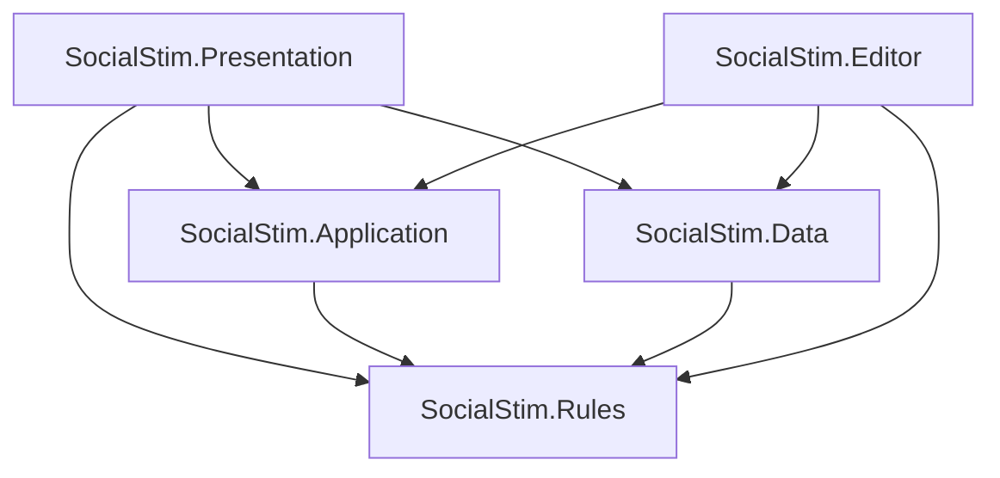

# Architecture

## Status and constraints

Milestones 01/02/05 provide the merged loop, attributed social evidence, scoped
NPC knowledge, conditional dialogue and presentation effects. This branch adds
milestone 03's role interactions, authored setup, morning/day flow and playtest
presentation changes. Ongoing-run save/resume was cancelled by the owner.

The player is a cast participant under the same legality rules as NPCs.
Dialogue remains prewritten data; no runtime generation service is used.
Rules and Application have no Unity references. Presentation owns uGUI/TMP
objects and display timing; those clocks never advance gameplay randomness.
Runs have no persistent state. Only UI/accessibility preferences persist.

Historical CI results apply to their recorded commits. The new shared compile
and behavioral suite must pass independently. Unity adapter/editor compilation,
actual rendering/input and player builds are still unverified here. The owner
is playtesting main; no feature branch authorizes an automatic merge.

## Assembly dependencies

Arrows below mean "depends on". Packages are omitted from this diagram.

| Assembly | Allowed project references | Unity access |
| --- | --- | --- |
| `SocialStim.Rules` | None | `noEngineReferences: true` |
| `SocialStim.Application` | Rules | `noEngineReferences: true` |
| `SocialStim.Data` | Rules | UnityEngine; no UnityEditor at runtime |
| `SocialStim.Presentation` | Rules, Application, Data | UnityEngine, uGUI/TMP, Input System |
| `SocialStim.Editor` | Rules, Application, Data | Editor-only |
| `SocialStim.Tests.EditMode` | Rules, Application, Data | Editor-only test assembly |
| `SocialStim.Tests.PlayMode` | All runtime project assemblies | Test assembly |

Project assembly references use stable `.meta` GUIDs. `autoReferenced` is false
to prevent accidental use by predefined assemblies. Do not put project scripts
outside these assembly roots. Tests opt in through `TestAssemblies` and
`UNITY_INCLUDE_TESTS`; Editor code is restricted to the Editor platform.

Rules and Application intentionally use a stronger constraint than the brief
requires: no Unity engine dependency. Data converts ScriptableObjects into
validated plain C# definition records at composition time. This avoids exposing
mutable Unity assets or scene APIs to rules and preserves simple EditMode tests.
No extra dependency-injection framework is needed.

## Files and namespaces

One top-level type per file; matching filename. Namespace roots are
`SocialStim.Rules`, `SocialStim.Application`, `SocialStim.Data`,
`SocialStim.Presentation`, and `SocialStim.Editor`, followed by subfolder names.
Scenes, authored JSON, and asset instances live outside code namespace roots.

| Folder | Responsibility |
| --- | --- |
| `Assets/_Project/Rules/Phases` | Explicit phase states and legal transitions |
| `Assets/_Project/Rules/Commands` | Validated player and NPC action commands |
| `Assets/_Project/Rules/Roles` | Role records, abilities, attack/defense policies |
| `Assets/_Project/Rules/Night` | Ordered resolver stages and visit tracking |
| `Assets/_Project/Rules/Cast` | Seeded identities, traits, and role assignment |
| `Assets/_Project/Rules/Reasoning` | Beliefs, evidence records, strategy implementations |
| `Assets/_Project/Rules/Dialogue` | Intent selection inputs, weighted lines, anti-repetition |
| `Assets/_Project/Rules/Victory` | Faction outcomes and personal achievements |
| `Assets/_Project/Rules/Randomness` | Specified PRNG with capturable stream state |
| `Assets/_Project/Application` | Session coordination, observations, input, cues |
| `Assets/_Project/Data/Definitions` | Definition types and validated runtime conversion |
| `Assets/_Project/Data/Dialogue` | Authored dialogue files; no generated runtime prose |
| `Assets/_Project/ScriptableObjects` | Role, setup, personality, catalog, and later effect assets |
| `Assets/_Project/Presentation/Text` | Text presenter, views, input, composition root |
| `Assets/_Project/Presentation/Effects` | TMP vertex adapter, overlay geometry, palettes, cue profile assets |
| `Assets/_Project/Scenes` | Future bootstrap, game, and playground scenes |
| `Assets/_Project/Editor/EffectsPlayground` | Editor-only portable timing and palette preview |
| `Assets/_Project/Tests` | EditMode rules tests and PlayMode adapter tests |

Empty folders are tracked with `.gitkeep` files, which Unity ignores. Folder and
asset `.meta` files are committed; moving assets must preserve those GUIDs.

## Composition and Unity integration

One scene-facing composition root will hold the authored catalog and view
references. It will convert definitions, construct a session with constructor
injection, subscribe the presenter, and dispose subscriptions on teardown.
MonoBehaviours adapt scenes, input devices, and views; they contain no game rules.
ScriptableObject definitions are treated as immutable during a run.

Use an inspector-referenced content catalog initially. It makes content
dependencies explicit without string-based Resources lookups or Addressables
setup. Introduce Addressables only when measured content size, asynchronous
loading, or distribution requirements justify it.

Use session-scoped C# events, rather than global ScriptableObject channels, for
game observations. A globally readable private event channel is an information
leak. ScriptableObject profiles remain appropriate for authored presentation
configuration. No service locator, singleton, or global random state is planned.

## Runtime flow and patterns

1. A Factory resolves role-list constraints, player assignment, names, and traits.
2. A State machine requests commands for Discussion, Nomination, Defense,
   Judgement, LastWords, NightSelection, NightResolution, Dawn, and Ended.
3. Player input and NPC Strategy implementations submit the same Commands.
4. Rules validate phase, actor survival, knowledge, resources, and legal targets.
5. The night Pipeline resolves accepted intents in documented stages.
6. Authoritative events update run state and evidence; Application derives
   recipient-specific observations and semantic presentation cues.
7. Win-condition Strategies return faction and personal outcomes at defined
   stable boundaries. Observer subscriptions update the current view.

The first day begins with Discussion and no prior-night result. No-execution
days proceed to NightSelection. Acquittal returns to nomination when a trial
remains, otherwise proceeds to night. Execution ends trials for that day.
Daytime execution and the completed night batch are stable win-check boundaries.
Endless runs need a later documented stalemate/turn-cap policy, not an accidental
"Town wins" fallback.

Roles compose ability definitions, resources, immunities, appearances, and win
policies. New role assets reuse existing ability implementations. A new mechanic adds an ability/stage and explicit registration in NightResolver,
with corresponding legality, result, strategy and outcome changes as needed. IDs and handler
compatibility are validated before a run. Do not rely on reflection-based type
discovery that may fail under build stripping.

## Hidden information

Authoritative state is private to the session/rules implementation. Public
Application contracts expose only player-authorized observations, public facts,
input requests, and display cues. NPC strategies consume a restricted knowledge
snapshot and their own evidence history. Debug views require explicit opt-in
and cannot supply inputs to the strategy in normal play.

| Information | Allowed recipients |
| --- | --- |
| Public accusation, nomination, vote, claim | Living participants and spectator transcript |
| Private ability result | Acting character, unless role rules specify otherwise |
| Antagonist membership / team plan | Roles explicitly granted teammate knowledge |
| Unrevealed true role | Authoritative rules; owner if their role is known to them |
| Death role | Everyone only when reveal-on-death is enabled |
| Pending hostile action | No target notification before a legitimate report |

A claim is an assertion, not a fact. Store speaker, target, alleged role/result,
time, provenance, and audience. Contradiction detection compares assertions
with permitted evidence. A role-gated dialogue condition must use the speaker's
allowed knowledge, not a target's secret role. Do not send internal events to a
view and expect it to filter them correctly.

## Reasoning and dialogue

`BeliefState` stores attributed evidence, bounded suspicion/trust, and an exposure
estimate for one observer. `BeliefDistribution` combines bounded evidence weights
with publicly announced initial faction counts. It normalizes role and faction
estimates to 10000 basis points, excludes known unique roles elsewhere, and never
recalculates priors from unrevealed death alignments. These are heuristic beliefs,
not calibrated Bayesian posteriors or exact joint role-list inference.

Evidence distinguishes public assertions, public ballots/deaths/reveals, and
legitimate private results. Self-exposure depends on visible reactions, never
private knowledge alone. Both production strategies are stateless across observers;
state belongs to each observer's model. A new strategy must not cache one NPC's
private facts for another NPC. `KnownCharacter` contains observer estimates rather
than authoritative assignments. See `Docs/SOCIAL_REASONING.md` for model policies.

`TeamNightPlanner` accepts authorized proposals without cast-role objects. Target
selection uses proposal count, permitted threat priority, and stable ID. A player
killer controls the final target/pass. Plans enter antagonist-only knowledge and
a living antagonist player's private transcript. Town/Neutral receive neither.

Dialogue version 2 adds AND-combined predicates over public phase/day, speaker
traits/own role, assertions, permitted evidence, and visible pressure. Context is
captured before publishing a statement, so it cannot create its own eligibility.
Generic fallbacks are mandatory; anti-repetition never relaxes conditions. Schema
1 remains supported without conditions. Presentation parses supported semantic markup independently of the rules.

Difficulty changes Strategy implementations, not access to secret truth.
Antagonists share only role-authorized team facts and a deterministic target plan.
Self-exposure estimates use observed reactions, not other characters' private
beliefs. Stable ordering breaks ties before any explicitly seeded random choice.

Dialogue selection uses intent, permitted context, authored conditions, weighted
sampling, and a run-local per-speaker recent-line history. Personality affects intent
utility and authored line suitability. Selection treats text as opaque, including
future markup. Adding lines must require data edits only. See
[Docs/DIALOGUE_AUTHORING.md](Docs/DIALOGUE_AUTHORING.md).

Player choices expose available assertions and likely social meaning. The normal
UI does not expose exact NPC belief deltas. Truthful and deceptive variants both
use the same command and evidence pipeline.

## Determinism and one-sitting runs

Use IRandomSource with the specified versioned algorithm and independent setup,
NPC decision and dialogue streams. Keep presentation timing independent of
gameplay randomness, sort decisions by stable IDs, and use integer weights.
A seed reproduces a run only with matching content/rules and player commands.

Runs are intended to be completed in one sitting. There is no run snapshot,
resume protocol, gameplay save slot, or saved input/observer state. New run
starts fresh. Only presentation/accessibility preferences persist through the
Unity-facing UiPreferences adapter.

## Presentation and effects

Current ports are `IGameView` and `IPlayerInputProvider`. `GamePresenter` routes
portable option IDs to `GameController` and scoped requests back to the view.
`RunSession.Observation` emits only public/player-private records. Additional
dialogue or cue ports wait for a distinct consumer. UI objects never appear in
these payloads. A future front end implements the same ports and semantic cues.

One presenter routes all text and cues. The current view delegates display playback
to the engine-free `DisplayPlayback`, cached `TextEffectRenderer`, and
`ScreenEffectOverlay`. A view-wide outstanding acknowledgement gates input.
Rules finish a command synchronously; display timing never advances rules or RNG.
The design contract is implemented by one playback director
using ScriptableObject cue profiles and semantic style mappings. Text geometry,
text color, screen tint, borders, and motion are separate channels. Profiles define
sequence/parallel execution, intensity, easing, priority, blending, cancellation,
and restoration. Conflicts use deterministic priority and cue-order tie breaks;
exclusive channels replace their previous owner, additive channels clamp output.
Each command declares its channel and blend policy. Skipping completes an
outstanding display acknowledgement exactly once and restores owned properties.

Use TMP vertex data for character animation and UI overlay images for borders,
vignettes, fades, and flashes. Screen Space - Overlay renders after camera output;
camera post-processing does not automatically affect it. URP, Shader Graph, and
Cinemachine are not dependencies until their effects solve an actual need.
Do not rebuild strings, allocate collections, or create materials per frame in
effect updates; cache baseline vertices and reuse buffers.

Rules emit facts, not colors, shaders, or effect names. Application can pause for
an explicit input/display acknowledgement, never for an effect duration. No timer
or animation callback can alter targeting, RNG, or victory resolution.

Application's future tension signal uses **player-visible evidence only**.
Hidden targeting, undiscovered deaths, and private NPC beliefs must not leak into
ambient effects. Reduced motion, adjustable intensity, disabled/limited flashes,
skip, and non-color indicators are required. The milestone 05 branch implements
strict semantic markup, timeline profiles,
portable acknowledgement, TMP/overlay adapters, and an editor playground.
See `Docs/EFFECTS.md` for exact conflict and cancellation policies. Runtime
allocation profiling, editor import, and real UI verification remain open gates.

## Tests and limitations

Shared test source must remain compatible with Unity's NUnit API. A reported
editor CS1503 error exposed a collection assertion using a newer `Contain`
overload. Collection membership now uses `Has.No.Member`; string containment
keeps `Does.Contain`. Headless CI compiles against upstream NUnit 3.5.0 on .NET Framework 4.7.2
and runs the suite with NUnit 3.14.0 on .NET 8 to detect this API gap. Unity's custom NUnit integration and real editor
compilation remain a distinct gate.

The Input System package is already a dependency, but package installation does
not select the project's active input backend. Choose Input System Package (New)
in Player settings and restart the editor. The content validation menu now
rejects an inactive Input System with that exact setup instruction. No generated
PlayerSettings asset is synthesized or used to overwrite local editor settings.

Milestone 00's static validator checks file/metadata pairing, GUID uniqueness,
assembly references and dependency cycles, layer constraints, package/version
pins, and unwanted files. Unity import and compilation remain unverified until
the pinned editor is available. The PlayMode assembly now includes presenter and TMP adapter checks; Unity execution remains pending.

Milestone 01 tests cover legal transitions, trial limits and ties, command
parity for player/NPCs, blocked actions, protection/attack interactions, simultaneous
deaths, victory boundaries, deterministic replay, and secret-information isolation.
Dialogue tests also cover eligibility/repetition and actual JSON loading. A
headless .NET test project compiles actual shared sources with warnings treated
as errors and completes 50 seeds for each of Town and antagonist play. This
verifies consistency and termination, not balance or enjoyment. Later tests cover
advanced role interactions and effects. Do not add tests that only
assert the scaffold's existence or mirror implementation details.

## Design risks

- Opaque or predictable NPCs: retain debug evidence traces and test competing
  interpretations of the same observations.
- Dialogue repetition: author broad intent coverage and validate fallbacks;
  random selection cannot substitute for content volume.
- Role interactions: define stage semantics and build a targeted interaction
  matrix before increasing the catalog.
- Antagonist passivity: test kills, false reports, alibis, and teammate management
  as player tools, not merely survival through voting.
- Architecture leaks: prevent unrestricted state/events from entering views,
  dialogue conditions, NPC strategies, or tension cues.
- Neutral outcomes and parity: evaluate capabilities and competing threats;
  faction headcount alone is not sufficient in the full ruleset.
- Premature visual scope: establish readable plain-text play before animation.

Milestones 02 and 05 share a single speech event per line, carrying public
intent/target metadata after observer evidence is updated. Nomination ballots
are chosen before publication and enter public evidence; deaths also enter
evidence when role reveal is disabled. Integration regression tests cover all
three contracts.

## Milestone 03 integration

RoleList/RoleSlot resolve authored constraints with deterministic bounded search;
unique roles and a chosen player role are validated together. Unity's
RoleListDefinition converts authored slots into detached rules. Citizens have no
visiting ability and may repeat. New enum values are appended to preserve
existing serialized values.

The default advanced night pipeline is block (10), forge (15), visits (20),
protection (30), simultaneous attacks (40), watch (45), investigation (50).
Forgery changes only a night-local appearance map. Watch reports only actual
visitors to its authorized recipient, with no role or attacker label. Limited
attacks spend a charge when executed, even against protection; blocked/pass
orders do not spend. Only Antagonist attacks enter the single team plan.

CapabilityWinCondition evaluates living roles/resources. Conservative parity
waits for usable Town attack/block/protection and independent killers. The day
cap bounds unresolved combat and protection loops. Provocateur execution is a
separate recorded personal achievement and does not terminate faction play.

Morning reports use recorded own actions/results or public-role-based bluffing;
they enter the existing attributed evidence path. The player can yield the
opening without spending a discussion round. Reporting and opening state are
authoritative rules state; menu navigation and pacing are presentation state.

Dialogue display completion includes the reading pause. Speaker pacing derives
from public speaker/sequence IDs, never gameplay RNG. Category/family/page
navigation keeps original revision-scoped leaf IDs. Claim highlights and the
claim board are applied from delivered observations, not undisplayed future
claims. Static frames are separate uGUI objects and survive effects-off mode.

ParticipantCard is a scene UI component keyed by public CharacterId. Cards render
only identity, survival and authorized teammate knowledge. Status/cast updates
wait until pending observations finish, while claim highlights are applied as
their individual spoken observations complete.

## One-sitting run policy and cozy UI

The owner cancelled ongoing-run saving. The milestone 04 draft is closed and
none of its snapshot/file-store code is part of this branch. UiPreferences
persists only presentation booleans, intensity and text speed in PlayerPrefs;
GameBootstrap owns this adapter and the view raises SettingsChanged. New run
still creates fresh roles, beliefs, resources and random streams.

TextUiFactory caches a small rounded sprite and uses native sliced Image,
Outline and light Shadow components for surfaces. ParticipantCard remains a
public-identity object. Titles and action descriptions have separate hierarchy;
ChoiceFocusIndicator supports hover plus a textual keyboard marker and sage
focus tint. The palette distinguishes canvas, panel, button, text and subdued
frames. No generated scene objects or runtime textures are committed assets.

## Repository audit and configurable casts

The content editing entry point is [Docs/CONTENT_GUIDE.md](Docs/CONTENT_GUIDE.md).
StarterDialogue contains 70 authored natural variants. NightActionText holds
first-person selection wording; RunSession shares result descriptions between
private delivery and attributed action reports. Short UI copy remains in the
application controller and Unity view.

GameBootstrap supplies a participant count. Positive counts ask RoleListDefinition
to scale authored faction shares through RoleList.ForPopulation; zero loads
exact slots. Both paths use the same constrained role resolver and validate a
chosen role, unique definitions and name availability. The old 20-participant
and 64-definition limits are removed; bounded search still prevents runaway
constraint resolution. The legacy seven-person factory fallback now uses the
same resolver instead of a second assignment algorithm.

Turn submission rejects synchronous callback reentry. PlayerView exposes the
configured discussion length so presentation warmth does not assume three rounds.
Participant and claim strips have horizontal ScrollRects. The editor preview
uses the same day-light/night-dark direction as gameplay. No save/resume system
is introduced.

## Mission part two: audit baseline and first repairs

The controlling phase plan is [Docs/AUDIT.md](Docs/AUDIT.md). Future discussion,
role, settings, inference, dialogue and effect systems described there are planned,
not implemented. Work uses phase branches/PRs and never writes directly to main.

DisplayPlayback now separates acknowledgement completion from retained text-motion
lifetime. Explicit continuous TextShake tracks keep ticking after reveal/skip;
Cancel or replacement removes them. Screen channels remain bounded, and continuous
flash is rejected. EffectSequence and inspector conversion preserve this policy.
The existing timed pulse contract is unchanged for non-continuous tracks.

TextGameView groups all display settings in a separate panel with reset defaults.
Default reveal speed is 84 text elements/second; existing saved choices remain
valid. Policy changes clear any retained animation. Day/night palettes are unchanged.
Both NPC strategies veto hostile Town choices against hard observer-known Town
alignment, independent of stale suspicion. These repairs do not implement the
mission's joint-world inference or new role catalog.

## Mission Phase 1A: discussion and plurality vote

See [Docs/DISCUSSION_VOTING.md](Docs/DISCUSSION_VOTING.md) for the implemented
contract, explicit UI limitations and manual checklist. Gnosia mode is the new
run default. Trial Mode remains an explicit alternative; legacy regression
fixtures select Trial instead of silently changing their behavioral contract.

DiscussionSchedule counts ordinary windows. DiscussionExchange owns the public
speaking queue and priority responses, independent of authoritative role state.
RunSession supplies scoped strategy decisions and emits existing speech evidence.
PluralityResult is a detached public tally; no ballot is published until all
voters decide. Appended Voting/VoteReveal phases guard the single-revote and
elimination boundary. PlayerView exposes public round/window/response/candidate
state, and GameController creates valid revision-scoped choices. New bootstrap
fields use default group rounds of five while preserving old scene fields for
Trial Mode. No scene YAML or existing metadata GUID is rewritten.

This is the Phase 1A loop foundation, not the complete interaction/UI rewrite.
Current-menu replacement, reason-tagged phrasing, current-line presentation and
the drawer remain subsequent work. No main commit/merge is performed.

Settings now use immutable preferences, versioned JSON persistence and a grouped
modal with immediate display edits and next-run game configuration. See
[settings contracts and Unity checks](Docs/SETTINGS.md).
